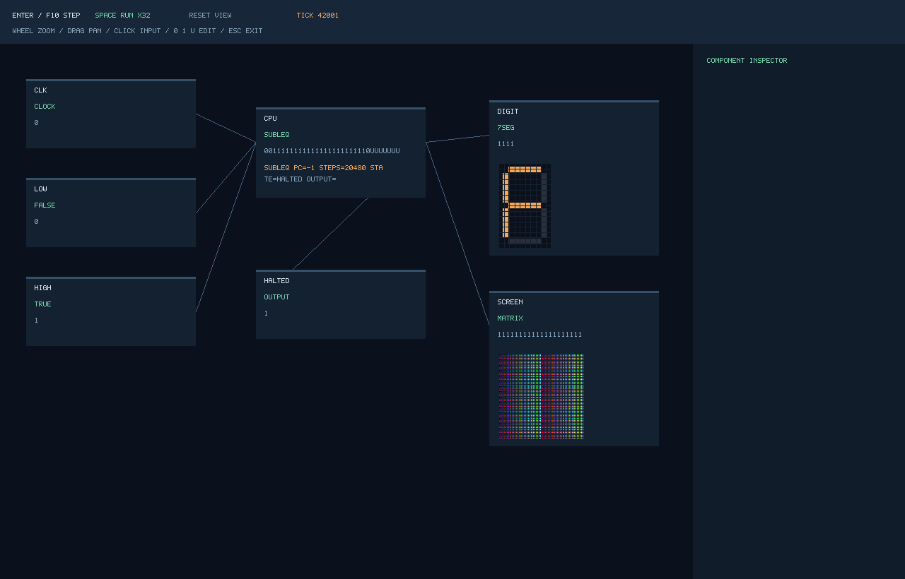
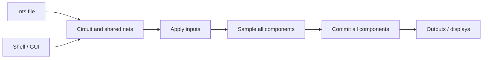

# NanoTekSpice

A remake and enhanced version of the original project I completed during my **second year at Epitech**. This version reworks the implementation and adds features beyond the original scope.

**Goal:** simulate digital circuits described in `.nts` files. Components communicate through linked pins, propagate **0 / 1 / U** logic, and advance through clocked simulation steps controlled from a shell.

This C++20 implementation includes CMOS chips, RAM/ROM, a native SDL2 circuit viewer, display components, and a programmable SUBLEQ computer.

## What it simulates

| Component family | Included behavior |
|---|---|
| Sources and logic gates | Inputs, clocks, constants, outputs, AND/OR/XOR/NOT, and six DIP gate packages |
| Arithmetic and selection | Four-bit adder `4008`, selector `4512`, and decoder `4514` |
| Sequential circuits | Dual D flip-flop `4013`, counters `4017`/`4040`, and shift register `4094` |
| Memory and logging | `4801` RAM, `2716` ROM loaded from `rom.bin`, and byte logging to `log.bin` |
| Bonus devices | Hexadecimal seven-segment display, RGB332 64×64 matrix, and a programmable CPU |

The simulator models pins and shared electrical nets, including fanout and conflicting drivers. An unknown value remains **U**; a disabled three-state output releases the bus internally.

## Quick start

Dependencies: C++20, CMake ≥ 3.20, Make, and Python 3 for tests. SDL2 is required for the native window.

<details>
<summary>Install dependencies</summary>

```sh
# macOS
brew install cmake pkg-config sdl2-compat
# Debian / Ubuntu
sudo apt-get install build-essential cmake pkg-config libsdl2-dev python3
```

</details>

```sh
make
make test
./nanotekspice examples/logic/half_adder.nts
```

| Shell command | Effect |
|---|---|
| `name=0`, `name=1`, `name=U` | Queue an input assignment |
| `simulate` | Apply pending inputs and advance one tick |
| `display` | Print the tick, sorted inputs, and sorted outputs |
| `loop` | Simulate continuously; Ctrl+C restores the prompt |
| `exit` / EOF | Quit |

Assignments are deferred. An uninitialized input is U. Errors: stderr and **84**; success: **0**.

## Circuit examples

The [examples/ catalog](examples/README.md) contains runnable `.nts` circuits for gates, CMOS chips, counters and memories. [Bonus examples](bonus/examples/) include the computer, keyboard, matrix and seven-segment display. All are included in the repository and release archives.

## Minimal circuit

The `.chipsets:` section declares components; `.links:` connects their numbered pins. This example connects two inputs to an AND gate and exposes its result:

```text
.chipsets:
input a
input b
and gate
output result
.links:
a:1 gate:1
b:1 gate:2
gate:3 result:1
```

After loading the file, enter `a=1`, `b=0`, then `simulate` and `display`: `result` is **0**. Setting both inputs to 1 and simulating again produces **1**.

## Circuit viewer and computer

The native viewer displays the actual circuit, pin values, and connected devices. It uses the same simulation engine as the shell.

```sh
./nanotekspice --program cpu bonus/examples/paint.subleq --set clk=0 \
  --gui bonus/examples/computer.nts
```

Enter: one tick; Space: run/pause; wheel: zoom; drag: pan. Select an input, then press 0/1/U to queue its value. SVG/HTML exports are circuit snapshots.

| Example program | Result |
|---|---|
| `triangular.subleq` | Computes 10+9+…+1 = **55**; the low four output bits display **7** |
| `paint.subleq` | Runs the CPU to write all **4,096 pixels** through the connected matrix bus |
| `echo.subleq` | Waits for a keyboard-bus byte, echoes it, then halts |

The CPU implements **SUBLEQ**, a one-instruction architecture with variable-precision integers and addresses. It is an alternative processor design, not an Intel 4004 emulator.



## How simulation works



Each tick applies pending inputs, samples every sequential component, commits their new state, then invalidates caches. A chain of registers therefore observes the previous state consistently, regardless of component-name order.

Combinational values are evaluated on demand with cycle guards. The circuit owns components through `IComponent`, allowing new chip types without depending on their concrete classes.

## Documentation

| Topic | Guide |
|---|---|
| Pinouts and unknown states | [Components](doc/COMPONENTS.md) |
| GUI, matrix, seven-segment display, computer | [Bonuses](bonus/README.md) · [CPU](bonus/CPU.md) |
| Subject coverage | [Requirements](doc/REQUIREMENTS.md) |
| Build, tests and memory checks | [Testing](doc/testing.md) |
| Optimization | [Profiling](doc/performance.md) |
| Binary archives | [Release guide](doc/releasing.md) |
| API | [IComponent contract](include/nts/CONTRACT.md) |

Types live in `include/nts/`, methods in `src/`, and extensions in `bonus/`. Strict compilation with `-Werror`.

Digital simulation has no analog voltages or propagation delays. Limits: 4 MiB files, 8,192-byte lines, 100,000 components, 500,000 links, combinational recursion depth 512. U remains distinct from internal high impedance.

MIT license for the remake implementation; see [third-party notices](THIRD_PARTY_NOTICES.md) for supplied reference material and dependencies.
