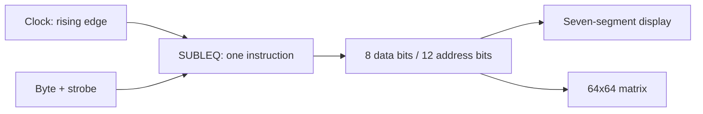

# SUBLEQ processor

`subleq` (alias `cpu`) is a one-instruction architecture permitted as an i4004 alternative. Signed integers and addresses have variable precision; instructions/data share associative memory. Missing cells are zero.

```text
(a, b, c) = memory[PC .. PC+2]
memory[b] -= memory[a]
PC = c if memory[b] <= 0, otherwise PC + 3
Negative PC: halt
```

The abstract model is Turing-complete; this implementation has finite resources. Reference: [Mazonka and Kolodin, 2011](https://arxiv.org/abs/1106.2593).

## Assembler

| Syntax | Meaning |
|---|---|
| `name:` | Label at current address |
| `subleq a b c` | One three-word instruction |
| `.word values...` | Data; plain number/label lines are also accepted |
| `.org address` | Next nonnegative, variable-precision address |
| `.entry label_or_address` | Initial PC, default zero |
| `.halt` | Shorthand for `0 0 -1` |

Comments use `#` or `;`; labels resolve in two passes. Duplicate/missing labels, negative/overlapping sections, and invalid instructions are rejected without replacing the loaded program.

## Ports

| Operands | Effect |
|---|---|
| `a=-1`, `b>=0` | Read pending byte into `memory[b]`; wait at this instruction if none is available |
| `b=-1`, `a>=0` | Emit low eight bits of `memory[a]`, continue; ignore `c` |
| `b=-2`, `a>=0` | Emit color `memory[a] mod 256` at pixel address `memory[c] mod 4096`, continue |

Without input, the CPU stays WAITING without consuming an instruction. Port data/address reductions do not limit internal arithmetic precision.

## Pinout

| Pins | Direction | Purpose |
|---|---|---|
| 1 | Input | Clock; execute on a known 0→1 edge |
| 2 | Input | Active-high reset: restore program image, PC, queues, outputs |
| 3 | Input | Active-high enable; reset must be 0 to execute |
| 4..11 | Output | Data/color, least significant bit first |
| 12..23 | Output | Pixel address, least significant bit first |
| 24 | Output | HALTED |
| 25 | Output | WAITING |
| 26..33 | Input | Keyboard/input byte, least significant bit first |
| 34 | Input | Strobe: enqueue known byte on a known 0→1 edge |

U transitions do not create known edges. A strobe with U data enqueues nothing. Outputs stay U before emission and after reset. Examples use reset=`false`, enable=`true`, clock initialized to 0.



## Budgets and evidence

| Resource | Default limit |
|---|---:|
| Memory cells | 1,000,000, configurable in `Subleq` |
| Source / line | 4 MiB / 65,536 characters |
| Output events | 1,048,576 |
| Input queue | 65,536 bytes |
| Execution | One instruction/edge; `run(budget)` always bounded |

Budget overflow raises a diagnostic exception. Integers remain limited by host memory. [Runnable examples](examples/): calculate 55, countdown, Hello, echo, full matrix painting. The independent Python oracle checks CPU behavior; the [test guide](../doc/testing.md) includes Valgrind commands.
